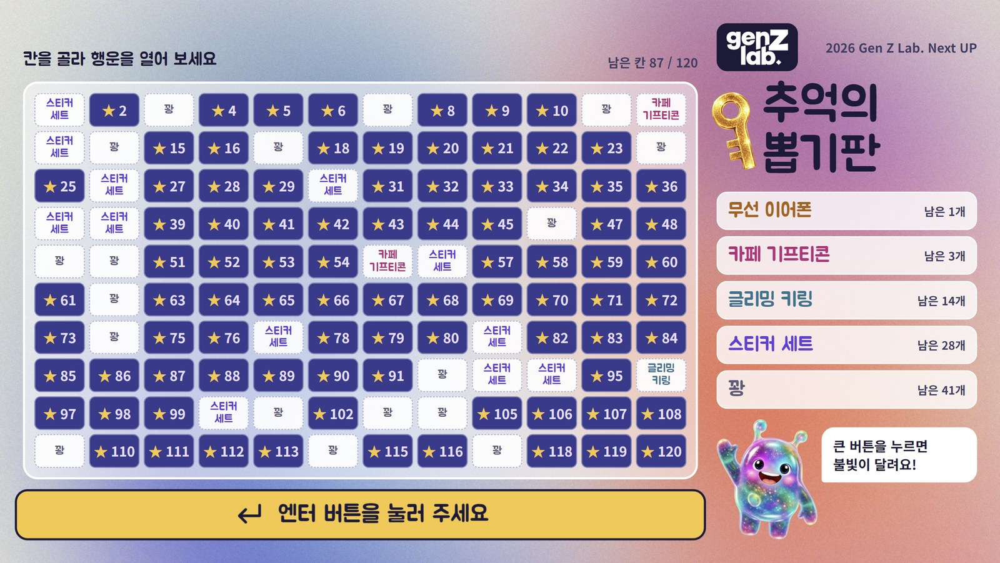
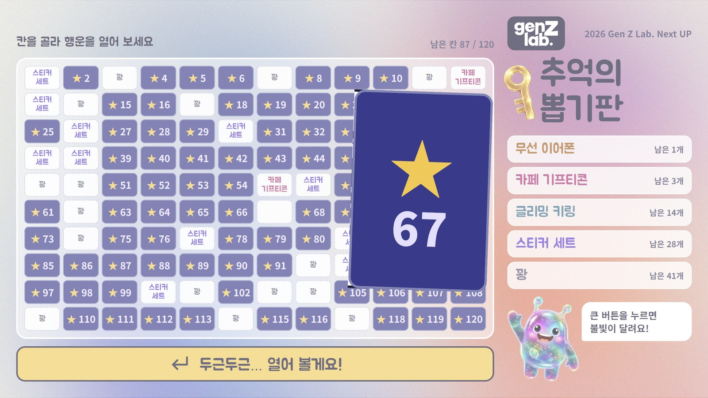
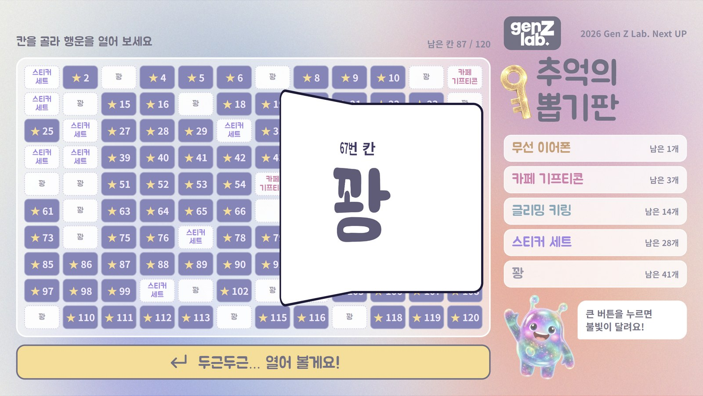
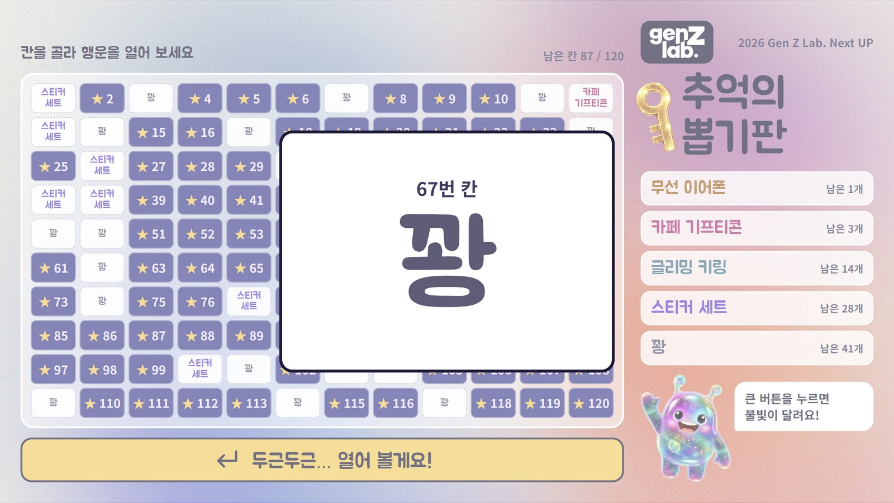
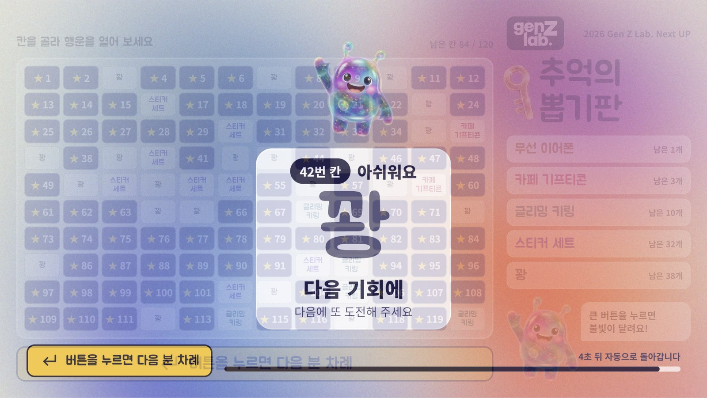
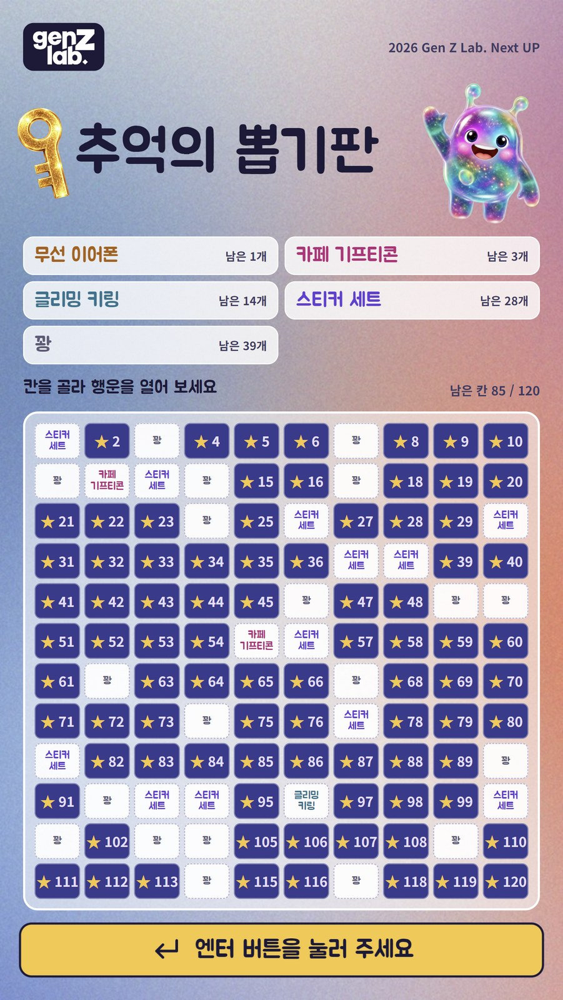
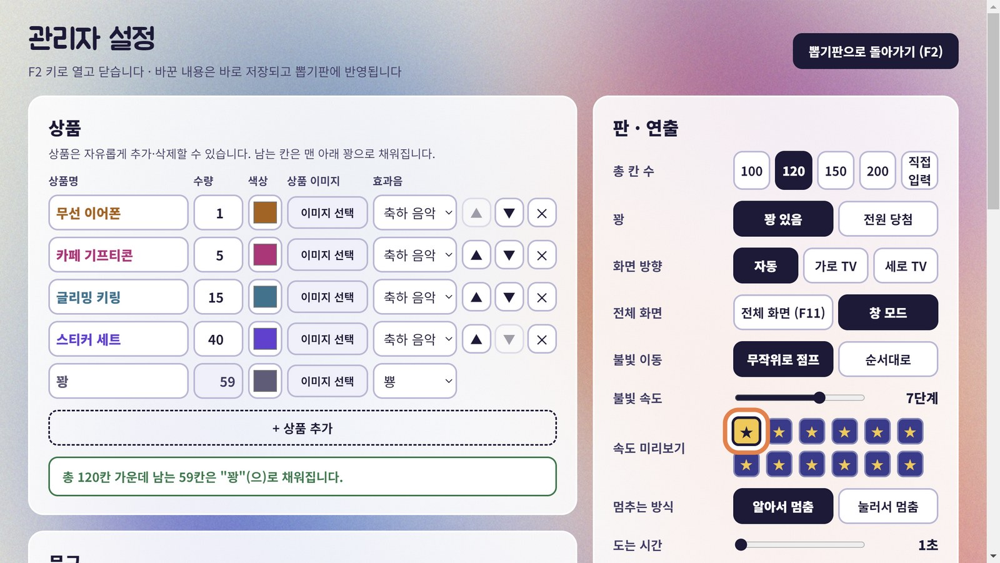

# Gen Z Lab. 뽑기판 (Retro Punch Board)

**2026 Gen Z Lab. Next UP 홍보 행사**를 위해 만든 "추억의 뽑기판" 프로그램입니다.
문방구 앞 종이 뽑기판을 큰 TV 화면으로 옮겼습니다. 참여자가 엔터 모양 쿠션 버튼을 한 번 누르면 불빛이 돌다가 멈추고, 그 칸의 접힌 종이가 빠져나와 펼쳐지면서 상품이 공개됩니다.



- 설치도 인터넷도 필요 없는 **exe 파일 하나**로 실행됩니다.
- 버튼 **하나**(엔터 키)로 한 사람씩 계속 진행됩니다.
- 상품, 칸 수, 문구, 색상, 연출 시간을 **관리자 화면에서 모두** 바꿀 수 있습니다.
- 뽑을 때마다 자동 저장되어, 프로그램이 꺼져도 **뽑던 판이 그대로** 이어집니다.

## 다운로드

[**최신 버전 받기 (Releases)**](https://github.com/Ooohje/genz-lab-Retro-Punch-Board/releases/latest)

| 파일 | 대상 |
|---|---|
| `GenZLab-PunchBoard-1.1.1-x64.exe` | 일반 Windows PC (대부분 이 파일) |
| `GenZLab-PunchBoard-1.1.1-arm64.exe` | ARM 방식 Windows PC (Snapdragon 노트북 등) |
| `USAGE-ko.txt` | 행사 운영자용 사용 안내 (한국어) |

서명이 없는 프로그램이라 처음 실행할 때 "Windows의 PC 보호" 경고가 뜹니다. **추가 정보 → 실행**을 누르면 됩니다.

## 진행 모습

엔터를 누르면 불빛이 돌다가 멈추고, 멈춘 칸의 접힌 종이가 그 자리에서 빠져나옵니다.



접힌 종이가 펼쳐지면서 결과가 보입니다.

| 펼쳐지는 중 | 다 펼쳐짐 |
|---|---|
|  |  |

이어서 축하 음악과 함께 결과 화면이 나오고, 버튼을 누르거나 잠시 기다리면 다음 사람 차례로 넘어갑니다.



세로로 세운 TV에도 맞춰집니다.



## 사용법

| 키 | 동작 |
|---|---|
| `Enter` / `Space` | 뽑기 진행 (엔터 쿠션 버튼은 USB에 꽂으면 엔터 키로 동작) |
| `F2` | 관리자 설정 열기 / 닫기 |
| `F11` | 전체 화면 켜기 / 끄기 |
| `Esc` | 관리자 설정 닫기 |

마우스를 움직이면 화면 오른쪽 위에 **설정**과 **전체 화면** 버튼이 잠깐 나타납니다.

### 진행 방식 3가지

`F2` → **판 · 연출 → 진행 방식**에서 고릅니다.

| 방식 | 동작 |
|---|---|
| **알아서 멈춤** (기본) | 엔터를 한 번 누르면 불빛이 돌다가 알아서 멈추고 상품이 열립니다. |
| **눌러서 멈춤** | 엔터를 누르면 불빛이 돌고, 한 번 더 누르면 멈춥니다. |
| **계속 돌기** | 불빛이 항상 돌고 있습니다. 엔터를 누르면 그 자리에 바로 멈추고 상품이 열리며, 결과 화면이 끝나면 다시 스스로 돕니다. |

### 행사 전 준비

1. `F2` → **상품**에서 실제 상품명과 수량을 입력합니다.
2. **판 · 연출**에서 칸 수와 꽝 여부를 정합니다.
3. **운영 → 새 판 만들기**로 깨끗한 판을 만듭니다.
4. `F11`로 전체 화면을 켭니다.

## 관리자 설정 (F2)



| 구역 | 바꿀 수 있는 것 |
|---|---|
| **상품** | 추가, 삭제, 순서 변경, 상품명, 수량, 색상, 상품 이미지, 효과음 |
| **판 · 연출** | 칸 수(100/120/150/200/직접 입력), 꽝 있음·전원 당첨, 가로·세로, 전체 화면, 불빛 이동 방식과 속도, 진행 방식(알아서 멈춤·눌러서 멈춤·계속 돌기), 도는 시간, 멈추는 시간, 종이 보여주는 시간, 결과 유지 시간, 음량 |
| **문구** | 판 위 안내, 버튼 글자, 캐릭터 말풍선, 당첨·꽝 문구 |
| **꾸미기** | 배경·로고 이미지, 로고·캐릭터·열쇠·칸 번호 보이기/숨기기, 칸 색상, 강조 색상 |
| **운영** | 마지막 뽑기 되돌리기, 뽑기 기록 내보내기(CSV), 설정 내보내기·불러오기, 새 판 만들기 |
| **기본 정보** | 화면 제목, 행사 이름, 관리자 비밀번호 |

- 상품 이미지를 넣으면, 그 상품이 뽑혔을 때 결과 화면에 캐릭터 대신 그 이미지가 나옵니다.
- 상품은 판을 만들 때 칸에 미리 섞어 넣기 때문에, 입력한 수량만큼만 정확히 나옵니다.
- 진행 중에 수량을 바꾸면 이미 뽑힌 칸은 그대로 두고, 남은 칸에만 다시 섞습니다.
- 설정과 뽑기 상태는 PC마다 따로 저장됩니다. 다른 PC로 옮기려면 **설정 내보내기**로 만든 파일을 가져가 **설정 불러오기**를 합니다(상품 이미지는 다시 골라야 합니다).

## 개발

[Electron](https://www.electronjs.org/)으로 만들었고, 화면은 별도 도구 없이 HTML·CSS·JavaScript만 씁니다.

```bash
npm install
```

```bash
npm start
```

```bash
npm test
```

배포용 exe 만들기:

```bash
npx electron-builder --win portable --x64
```

README의 화면 캡처 다시 만들기:

```bash
npx electron scripts/capture.js
```

### 폴더 구성

```
main.js              프로그램 본체: 창 띄우기, 설정·뽑기 상태 파일 저장
preload.js           화면 코드에 내어 주는 기능 목록
renderer/
  index.html         화면 틀
  style.css          디자인과 애니메이션
  logic.js           뽑기 규칙(판 만들기, 섞기, 되돌리기, 기록) - 화면과 무관한 계산
  app.js             참여자 화면: 불빛, 종이 연출, 결과 화면
  admin.js           관리자 설정 화면
  sound.js           효과음
  assets/            배경, 캐릭터, 열쇠, 로고, 축하 음악
test/logic.test.js   뽑기 규칙 검사
scripts/capture.js   README용 화면 캡처
docs/                화면 캡처
```

## 만든 재료

- 캐릭터 "글리밍" 포즈, 배경을 지운 열쇠, 축하 음악은 [Higgsfield](https://higgsfield.ai/)로 만들었습니다.
- 글꼴은 [Jua](https://fonts.google.com/specimen/Jua)와 [Noto Sans KR](https://fonts.google.com/noto/specimen/Noto+Sans+KR)이며(SIL Open Font License), 인터넷 없이 쓰도록 프로그램 안에 넣었습니다.
- 로고와 캐릭터는 Gen Z Lab.의 것입니다.
